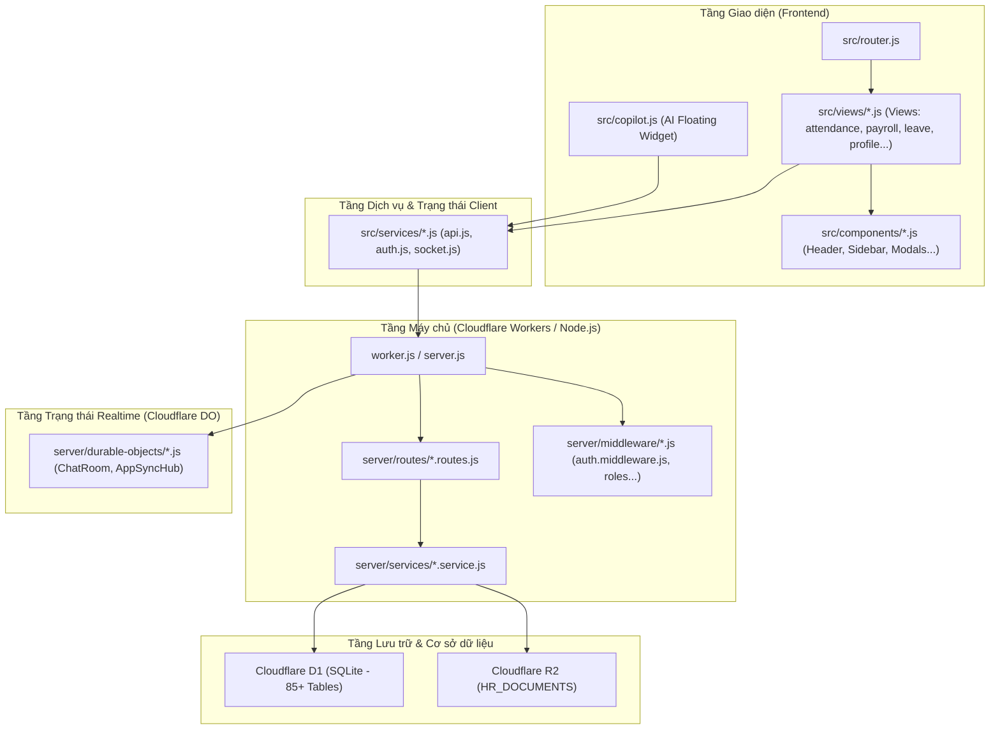

# Graphify — Codebase Knowledge Graph cho NetViet HR Marketing Pro

Biến toàn bộ mã nguồn của **NetViet HR Marketing Pro** thành một đồ thị tri thức có khả năng điều hướng, phát hiện cụm chức năng (Louvain/Leiden community detection), nhận diện "God nodes" (các file/hàm có quá nhiều phụ thuộc), và truy vấn đường dẫn luồng dữ liệu nhanh chóng.

---

## 1. Cấu trúc Ontology đặc thù của NetViet HR

Đồ thị tri thức của dự án phân tách thành 5 tầng kiến trúc chính:



---

## 2. Các lệnh truy vấn hữu ích trong dự án

Khi công cụ graphify đã được khởi tạo trong môi trường (`npm install -g @sentropic/graphify` hoặc qua runner nội bộ):

```bash
# 1. Quét toàn bộ kiến trúc dự án và tạo đồ thị
graphify . --scope auto

# 2. Truy vấn đường dẫn quan hệ giữa 1 View và 1 Bảng Database
graphify path "AttendanceView" "attendance_logs"

# 3. Phân tích vùng ảnh hưởng (Blast Radius) khi chuẩn bị sửa 1 Service
# Ví dụ: Sửa attendance.service.js sẽ ảnh hưởng những route và view nào?
graphify review-delta --files server/services/attendance.service.js --graph .graphify/graph.json

# 4. Truy vấn câu hỏi ngôn ngữ tự nhiên về quan hệ kiến trúc
graphify query "Những thành phần nào gọi tới copilot.service.js và các action confirm?"

# 5. Xuất báo cáo đồ thị tri thức
graphify summary --graph .graphify/graph.json
```

---

## 3. Bản đồ các "God Nodes" (Các nút trọng yếu cần cẩn trọng)

Trong hệ thống NetViet HR Marketing Pro, các file sau đây có độ liên kết cao nhất. Mọi thay đổi ở các file này đều có rủi ro tạo ra hiệu ứng dây chuyền (ripple effect):

1. **`server/services/auth.service.js` & `server/middleware/auth.js`**:
   - Quản lý phiên JWT, giải mã Role (Admin, BGD, HCNS, Manager, Employee, Intern).
   - Ảnh hưởng: Tất cả các route API trên hệ thống.
2. **`src/router.js` & `src/auth.js`**:
   - Điều hướng SPA, phân quyền guard theo Hash Route (`#/attendance`, `#/payroll`, `#/users`).
   - Ảnh hưởng: Toàn bộ điều hướng của người dùng ở frontend.
3. **`server.js` & `worker.js`**:
   - Cổng tiếp nhận toàn bộ HTTP request và WebSocket connection trên Cloudflare Workers.
4. **`scripts/d1-schema.sql`**:
   - Định nghĩa 85+ bảng cơ sở dữ liệu SQLite trong D1. Bất kỳ sự thay đổi tên cột hoặc ràng buộc foreign key nào đều phải kiểm tra toàn bộ `server/services/*.service.js`.

---

## 4. Quy trình áp dụng Graphify khi Refactor / Thêm tính năng

Mỗi khi nhận một yêu cầu thay đổi lớn (như mở rộng trường chấm công, bổ sung phân quyền BGD):

1. **Tra cứu đồ thị trước khi viết code**:
   - Kiểm tra xem chức năng này đã có service/endpoint nào làm tương tự chưa.
   - Xác định danh sách các View frontend đang render dữ liệu này.
2. **Liệt kê danh sách các điểm chạm (Touchpoints)**:
   - Frontend: `src/views/<feature>.js`
   - Client API: `src/services/api.js`
   - Backend Route: `server/routes/<feature>.routes.js`
   - Backend Service: `server/services/<feature>.service.js`
   - Database Schema: `scripts/d1-schema.sql`
3. **Xác minh không sót mắt xích**:
   - Đảm bảo rằng việc cập nhật backend service không làm vỡ các view của các role khác (xem chi tiết tại skill `sync-role-screens`).
