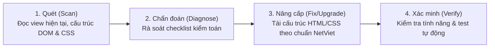

# Redesign Existing Projects — NetViet HR Marketing Pro

Phương pháp kiểm toán và nâng cấp toàn diện các màn hình trong hệ thống **NetViet HR Marketing Pro**, biến các giao diện quản trị khô cứng thành trải nghiệm làm việc trực quan, sang trọng, mang lại hiệu suất làm việc cao cho doanh nghiệp.

---

## 1. Quy trình 3 bước Redesign an toàn

1. **Scan (Quét)**:
   - Đọc file view trong `src/views/<module>.js` và CSS tương ứng trong `styles/main.css`.
   - Xác định luồng dữ liệu (Data fetch từ API, event listeners, state hiện tại).
2. **Diagnose (Chẩn đoán)**:
   - So chiếu với danh sách kiểm toán ở Mục 2. Liệt kê các điểm yếu về thẩm mỹ, phân cấp thông tin, hoặc khả năng phản hồi.
3. **Upgrade (Nâng cấp cục bộ)**:
   - Cải tiến giao diện ngay trên nền tảng Vanilla JS và CSS Variables hiện có.
   - **Tuyệt đối KHÔNG đập đi xây lại toàn bộ** khiến mất liên kết API hoặc lỗi router. Giữ nguyên các ID/class gắn với logic xử lý sự kiện hoặc refactor chúng có kiểm soát.
4. **Verify (Xác minh)**:
   - Chạy `npm test` và kiểm tra giao diện trên cả Desktop và Mobile.

---

## 2. Danh mục kiểm toán thiết kế (Design Audit Checklist)

### 2.1 Bảng dữ liệu nghiệp vụ (Data Tables: Chấm công, Bảng lương, Danh sách nhân viên)
- ❌ **Lỗi thường gặp**:
  - Bảng bị tràn ngang trên màn hình nhỏ mà không có thanh cuộn mượt mà.
  - Số liệu tiền tệ, ngày giờ căn lộn xộn (căn trái thay vì căn phải).
  - Thiếu trạng thái hover từng dòng (`table row hover`).
  - Tiêu đề cột trôi mất khi cuộn danh sách dài.
-  **Cách nâng cấp chuẩn NetViet**:
  - Bọc bảng trong container có `overflow-x: auto` và thanh cuộn mảnh (`scrollbar-thin`).
  - Cố định tiêu đề bảng khi cuộn dọc: `th { position: sticky; top: 0; background: var(--bg-surface); z-index: 2; }`.
  - Căn lề chuẩn: Văn bản căn trái, Số liệu (tiền lương, giờ công) căn phải + `font-variant-numeric: tabular-nums`.
  - Thêm phân trang (Pagination) hoặc bộ lọc nhanh theo phòng ban, trạng thái, tháng/năm.

### 2.2 Hồ sơ & Thông tin nhân viên (`src/views/profile.js`, `src/views/users.js`)
- ❌ **Lỗi thường gặp**:
  - Dồn tất cả thông tin vào một trang dài bất tận khiến người dùng khó tìm kiếm.
  - Avatar méo mó hoặc không có chữ viết tắt dự phòng khi thiếu ảnh.
  - Các thông tin nhạy cảm (Lương, BHXH) không được phân tách khu vực bảo mật.
-  **Cách nâng cấp chuẩn NetViet**:
  - Phân chia tab điều hướng rõ ràng:
    1. **Tổng quan**: Thông tin cơ bản, vị trí, phòng ban, thông tin liên hệ.
    2. **Công việc & Hợp đồng**: Loại hợp đồng, ngày bắt đầu, chức danh, quản lý trực tiếp.
    3. **Lương & Phúc lợi**: Lương cơ bản, phụ cấp, hệ số, tài khoản ngân hàng (phân quyền chỉ HR/BGD/chủ tài khoản xem được).
    4. **Tài liệu & Hồ sơ**: File đính kèm, CCCD, bằng cấp.
    5. **Dòng thời gian (Timeline)**: Lịch sử thăng tiến, chuyển phòng ban, khen thưởng/kỷ luật.
  - Avatar squircle hoặc tròn hoàn hảo, có màu nền dịu và hiển thị 2 chữ cái đầu nếu chưa có ảnh (ví dụ: "Nguyễn Trung Đức" $\rightarrow$ "TĐ").

### 2.3 Màn hình Chấm công (`src/views/attendance.js`)
- ❌ **Lỗi thường gặp**:
  - Nút Check-in đơn điệu, không hiển thị rõ tọa độ GPS hoặc trạng thái Wifi.
  - Thiếu phản hồi ngay lập tức sau khi bấm chấm công.
-  **Cách nâng cấp chuẩn NetViet**:
  - Thẻ trạng thái radar trực quan: Hiển thị vòng tròn radar quét vị trí GPS với huy hiệu rõ ràng:
    - 🟢 *"Trong khu vực văn phòng (Bán kính 200m - Hợp lệ)"*
    - 🟡 *"Ngoài khu vực văn phòng (Cần lý do hoặc duyệt WFH)"*
  - Nút Chấm công lớn (`min-height: 54px`), bo góc chuẩn, hiệu ứng phản hồi xúc giác khi bấm.
  - Thẻ tóm tắt ngày làm việc hiện tại: Giờ vào, Giờ ra, Số giờ làm tích lũy trong ngày, Trạng thái đi muộn/về sớm.

### 2.4 Luồng Phê duyệt đơn từ (`src/views/approvals.js`, `src/views/leave.js`)
- ❌ **Lỗi thường gặp**:
  - Không rõ đơn đang ở bước duyệt nào (Trưởng phòng hay Ban Giám Đốc?).
  - Bấm duyệt/từ chối không có dialog xác nhận lý do.
-  **Cách nâng cấp chuẩn NetViet**:
  - Tiến trình phê duyệt 2 cấp trực quan (Step Wizard / Stepper):
    - Bước 1: Nhân viên gửi đơn $\rightarrow$ Bước 2: Quản lý trực tiếp duyệt $\rightarrow$ Bước 3: HCNS / BGD duyệt $\rightarrow$ Hoàn tất.
  - Modal xác nhận từ chối bắt buộc nhập lý do để gửi thông báo lại cho nhân viên.

### 2.5 Trợ lý AI Copilot (`src/copilot.js`)
- ❌ **Lỗi thường gặp**:
  - Drawer chiếm toàn màn hình hoặc che khuất các nút thao tác chính.
  - Các nút hành động do AI gợi ý (Navigate, Gửi đơn) bị nhầm lẫn với nút submit form thông thường.
-  **Cách nâng cấp chuẩn NetViet**:
  - Widget nổi tinh tế góc phải với tiêu đề "HR Assistant Cá nhân", hỗ trợ thu gọn/mở rộng.
  - Nút điều hướng AI dùng class phân định riêng (`btn-nav-action`), không kích hoạt nhầm action confirmation handler.
  - Phân định rõ tin nhắn của Trợ lý (avatar cam + nền xám nhạt) và Nhân viên (nền trắng + bo góc mềm mại).

---

## 3. Checklist nghiệm thu sau khi Redesign

Mỗi khi redesign xong một màn hình:
- [ ] Giao diện mới có ăn khớp với bảng màu thương hiệu `#EE4D2D` và CSS của `styles/main.css` không?
- [ ] Các tính năng cũ (Click event, Submit form, Lấy dữ liệu API) vẫn hoạt động 100% bình thường?
- [ ] Bố cục hiển thị đẹp mắt trên màn hình Desktop (Sidebar) lẫn Mobile PWA (Bottom Nav)?
- [ ] Đã chạy `node scripts/sync-public.mjs` để đồng bộ tài nguyên frontend sang `.local-public` phục vụ Cloudflare Workers?
- [ ] Chạy `npm test` xác nhận không có bài test nào bị vỡ?
