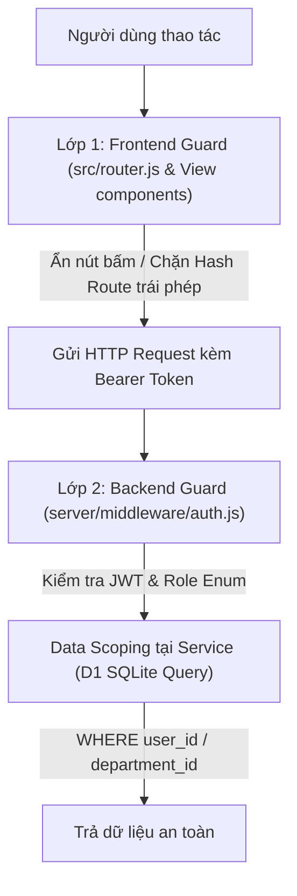

# Sync Role Screens — NetViet HR Marketing Pro

Quy trình đồng bộ giao diện và logic phân quyền 5 tầng vai trò (5-Tier Role Matrix) trong hệ thống **NetViet HR Marketing Pro**. Đảm bảo mọi tính năng được phản ánh nhất quán từ giao diện người dùng (Frontend SPA) đến bảo mật dịch vụ máy chủ (Backend API & D1 SQLite).

---

## 1. Ma trận 5 tầng vai trò (The 5-Tier Role Matrix)

Hệ thống NetViet HR phân cấp quyền lực nghiêm ngặt:

| Tầng vai trò | Mã Role | Phạm vi dữ liệu (Data Scope) | Thẩm quyền chính |
|---|---|---|---|
| **1. Quản trị viên** | `admin` | Toàn hệ thống (All Departments) | Cấu hình tham số, phân quyền tài khoản, xem audit log, toàn quyền can thiệp |
| **2. Ban Giám Đốc** | `ban_giam_doc` / `bgd` | Toàn công ty (All Departments) | Phê duyệt cấp 2 (cấp cao nhất), xem báo cáo chiến lược, tổng quỹ lương, KPI toàn diện |
| **3. Hành chính Nhân sự** | `hr` / `hcns` | Toàn bộ nhân sự (All Employees) | Quản lý hồ sơ, chốt bảng chấm công, tính bảng lương, hợp đồng, BHXH, duyệt đơn song song |
| **4. Quản lý bộ phận** | `manager` | Nội bộ phòng ban (`department_id`) | Duyệt đơn cấp 1 của nhân viên phòng mình, giao việc, chấm KPI nhân viên cấp dưới |
| **5. Nhân viên & TTS** | `employee` / `intern` | Chỉ riêng cá nhân (`user_id`) | Chấm công GPS/Wifi, nộp đơn từ cá nhân, xem phiếu lương của chính mình, chat nội bộ |

---

## 2. Nguyên tắc "Bảo vệ hai lớp" (Dual-Layer Protection)

Mọi chức năng phân quyền bắt buộc phải có mặt ở **cả hai tầng**:

1. **Lớp 1: Frontend Guard (UI Level)**:
   - Trong `src/router.js`: Nếu nhân viên (`employee`) gõ URL `#/hr-management` hoặc `#/payroll-admin`, router phải chặn ngay lập tức, chuyển hướng về `#/dashboard` và hiển thị Toast cảnh báo: *"Bạn không có quyền truy cập màn hình này"*.
   - Trong `src/views/*`: Dùng điều kiện `currentUser.role` để ẩn hoàn toàn các nút nhạy cảm (Nút "Duyệt đơn", Nút "Chốt lương", Nút "Xóa nhân viên").
2. **Lớp 2: Backend Guard (Service & DB Level)**:
   - **Tuyệt đối không chỉ tin tưởng frontend**: Kẻ xấu có thể dùng DevTools hoặc gọi API trực tiếp.
   - Trong `server/middleware/auth.js`: Chặn từ cổng với middleware `requireRole(['admin', 'hr', 'ban_giam_doc'])`.
   - Trong `server/services/*.service.js`: Câu lệnh SQL truy vấn D1 bắt buộc ràng buộc phạm vi:
     - Nhân viên: `WHERE user_id = ?`
     - Quản lý: `WHERE department_id = (SELECT department_id FROM users WHERE id = ?)`
     - BGD/HR/Admin: Được phép query không kèm điều kiện lọc phòng ban nếu cần.

---

## 3. Quy trình Trace & Sync khi thay đổi tính năng

Mỗi khi vừa thêm một trường thông tin hoặc sửa đổi một luồng logic:

### Bước 1: Liệt kê các Màn hình liên quan theo Role
*Ví dụ*: Bạn vừa thêm trường "Lý do WFH & Thiết bị mang về" vào đơn xin làm việc từ xa:
1. **Màn hình Nhân viên (`src/views/leave.js`)**: Form tạo đơn cần thêm ô nhập liệu này.
2. **Màn hình Quản lý duyệt (`src/views/approvals.js`)**: Thẻ hiển thị đơn cần hiện thêm lý do này để Trưởng phòng đọc trước khi bấm duyệt.
3. **Màn hình HCNS / BGD (`src/views/hr-management.js`)**: Bảng tổng hợp đơn WFH của toàn công ty cần hiển thị trường này để theo dõi tài sản công ty.

### Bước 2: Kiểm tra Backend Scoping
Kiểm tra endpoint `GET /api/approvals` hoặc `GET /api/leaves`:
- Khi tài khoản `manager` gọi: Backend có tự động lọc chỉ trả về đơn của nhân viên cùng phòng ban không?
- Khi tài khoản `employee` gọi: Backend có ngăn chặn không cho xem đơn của đồng nghiệp khác không?

### Bước 3: Kiểm tra Trợ lý AI Copilot
Nếu tính năng có thể kích hoạt qua chat với AI (ví dụ: *"Tôi muốn xin nghỉ phép ngày mai"* hoặc *"Duyệt đơn của bạn An"*):
- Kiểm tra `server/services/copilot.service.js`: AI có nhận diện đúng vai trò của người đang hỏi không?
- Đảm bảo AI **từ chối thực hiện action** nếu nhân viên nhờ AI duyệt đơn của người khác.

---

## 4. Checklist nghiệm thu Sync Role

Trước khi hoàn tất task:
- [ ] Nhân viên thường đăng nhập vào có bị lộ bảng lương của người khác không?
- [ ] Quản lý bộ phận có vô tình duyệt được đơn của nhân viên phòng khác không?
- [ ] Ban Giám Đốc và HCNS có nhìn thấy toàn bộ báo cáo và phê duyệt cấp cao không?
- [ ] Giao diện sidebar trên Desktop và Bottom Nav trên Mobile có ẩn các menu không thuộc thẩm quyền của role hiện tại chưa?
- [ ] Thử nghiệm trực tiếp với ít nhất 2 tài khoản có vai trò khác nhau (ví dụ: `admin@company.com` và nhân viên demo `ducnt.netviet@gmail.com`).
