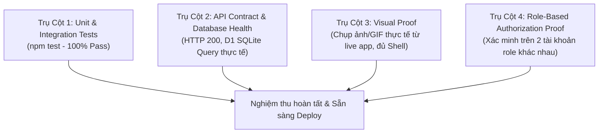

# Verification Protocol — 4 Trụ Cột Minh Chứng Thực Tế

Trong hệ thống **NetViet HR Marketing Pro**, mọi tính năng mới hoặc sửa lỗi đều phải được nghiệm thu thông qua **Giao thức Kiểm thử 4 Trụ Cột (4-Pillar Verification Protocol)**. Không chấp nhận các báo cáo mơ hồ kiểu *"đã sửa xong nên chắc chắn chạy được"*.

---

## 1. Bốn Trụ Cột Kiểm thử (The 4 Pillars)



### Trụ Cột 1: Kiểm thử tự động (Automated Tests)
- Chạy lệnh kiểm thử toàn diện:
  ```powershell
  npm test
  ```
- **Yêu cầu bắt buộc**: Cả 4 bộ test phải PASS 100%:
  1. `tests/geofence.test.js`: Tính toán khoảng cách Haversine, xác định nhân viên nằm trong/ngoài bán kính 200m văn phòng NetViet HCM.
  2. `tests/attendance-period.test.js`: Logic chốt kỳ công ngày 26 tháng trước đến 25 tháng này, tính toán làm tròn công 0.5/1.0.
  3. `tests/multi-proof.test.js`: Kiểm tra điều kiện chấm công đa yếu tố (GPS + Wifi BSSID + Ảnh chụp).
  4. `tests/security-audit.test.js`: Kiểm tra chống vượt quyền (Privilege Escalation), chặn truy cập trái phép.

### Trụ Cột 2: Xác minh API & Cơ sở dữ liệu Cloudflare D1
- Kiểm tra tính toàn vẹn của dữ liệu:
  - Gọi API thực tế hoặc kiểm tra mã HTTP phản hồi (`200 OK` hoặc `201 Created`).
  - Truy vấn trực tiếp Cloudflare D1 để chứng minh bản ghi đã thực sự được lưu vào bảng SQLite:
    ```powershell
    npx wrangler d1 execute nexrall-hr-demo --command="SELECT id, user_id, check_in_time, status FROM attendance_logs ORDER BY id DESC LIMIT 1;"
    ```
  - Cấu trúc phản hồi JSON phải tuân thủ định dạng chuẩn của NetViet:
    ```json
    { "success": true, "data": { ... }, "message": "Thành công" }
    ```

### Trụ Cột 3: Minh chứng trực quan thực tế (Visual Proof)
- **Không có thay đổi vô hình (No Invisible Changes)**:
  - Mọi thay đổi về giao diện người dùng (UI/UX) phải có hình ảnh chụp thật từ ứng dụng đang chạy:
    - Localhost: `http://localhost:3000`
    - Staging/Demo: `https://nexrall-hr-demo.netviet-hr-ios.workers.dev`
- **Quy tắc khung nhìn hoàn chỉnh (Layout Shell)**:
  - Bắt buộc chụp trong bối cảnh hoàn chỉnh của NetViet HR: Có Sidebar màu xanh navy đậm (`#0f172a`), Header trên cùng có hiển thị tên người dùng và Badge vai trò (ví dụ: `Admin`, `Thực tập sinh`, `Trưởng phòng`), và khu vực nội dung chính.
  - Không chụp ảnh crop cụt lủn một nút bấm hay một ô input cô lập.
- **Kiểm tra đa kích thước màn hình**:
  - Desktop Viewport: `1440x900` (kiểm tra bố cục rộng, không vỡ bảng dữ liệu).
  - Mobile Viewport: `390x844` (kiểm tra Bottom Nav Bar PWA, touch target $\ge 44px$, không bị thanh cuộn ngang vỡ màn hình).

### Trụ Cột 4: Xác minh phân quyền vai trò (Role Authorization Proof)
- Kiểm tra tính năng với ít nhất **2 tài khoản có vai trò khác nhau**:
  - Tài khoản Quản trị / Quản lý: Ví dụ `admin@company.com` $\rightarrow$ Thấy đầy đủ nút Duyệt, nút Sửa, bảng số liệu toàn công ty.
  - Tài khoản Nhân viên: Ví dụ `ducnt.netviet@gmail.com` $\rightarrow$ Nút duyệt bị ẩn, chỉ thấy dữ liệu cá nhân của chính mình.

---

## 2. Các hành vi bị CẤM TUYỆT ĐỐI (Strict Anti-Patterns)

1. 🚫 **TUYỆT ĐỐI CẤM TẠO FILE HTML MOCK / PREVIEW TĨNH**:
   - Nghiêm cấm tạo các file tạm như `test-preview.html`, `mock-ui.html` rồi mở bằng trình duyệt để chụp ảnh đối phó.
   - Mọi minh chứng không xuất phát từ ứng dụng đang chạy thật đều bị coi là **GIẢ MẠO VÀ BỊ TỪ CHỐI NGHIỆM THU**.
2. 🚫 **CẤM BỊA SỐ LIỆU TĨNH**:
   - Không được gán cứng các con số đẹp vào file JS nếu database thực tế trả về số liệu khác.
3. 🚫 **CẤM BÁO CÁO MƠ HỒ**:
   - Không dùng các câu chữ cảm tính như: *"Tôi đã sửa xong, chắc chắn giao diện đã chuẩn"*. Phải nêu rõ lệnh đã chạy và kết quả thực tế.

---

## 3. Mẫu báo cáo nghiệm thu 4 Trụ Cột

Khi hoàn thành task hoặc báo cáo người dùng, trình bày theo mẫu sau:

```markdown
### 🎯 Báo cáo Nghiệm thu 4 Trụ Cột — [Tên tính năng / Bug Fix]

#### 1. Kiểm thử tự động (npm test)
- [x] Đã chạy `npm test` - Kết quả: **PASS 4/4 suites (100%)**
- Log: `geofence.test.js: PASS`, `attendance-period.test.js: PASS`, `multi-proof.test.js: PASS`, `security-audit.test.js: PASS`.

#### 2. API & D1 Database
- [x] Endpoint: `POST /api/attendance/check-in` -> HTTP 200 OK
- [x] D1 Query: Đã lưu bản ghi mới vào bảng `attendance_logs` với `user_id = 576`, tọa độ hợp lệ.

#### 3. Minh chứng trực quan (Visual Proof)
- [x] Giao diện Desktop (1440px): Đầy đủ Sidebar, thông tin nhân viên hiển thị đúng chuẩn.
- [x] Giao diện Mobile PWA (390px): Bottom navigation hiển thị mượt mà, không vỡ layout.
- Ảnh chụp minh chứng: `docs/screenshots/<filename>.png` (hoặc ảnh đính kèm).

#### 4. Phân quyền vai trò (Role Proof)
- [x] Tài khoản Nhân viên (`ducnt.netviet@gmail.com`): Không xuất hiện nút duyệt đơn của người khác.
- [x] Tài khoản Admin (`admin@company.com`): Có đầy đủ thẩm quyền cấu hình và xem danh sách toàn công ty.
```

---

## 4. Checklist nhanh trước khi gửi nghiệm thu
- [ ] `npm test` chạy xanh 100% không có lỗi.
- [ ] D1 database phản hồi đúng dữ liệu thực tế.
- [ ] Ảnh chụp màn hình được lấy từ ứng dụng thật (`localhost:3000` hoặc Cloudflare Worker Demo).
- [ ] Đã xác nhận trên cả Desktop và Mobile viewport.
- [ ] Đã kiểm tra phân quyền tài khoản đầy đủ.
