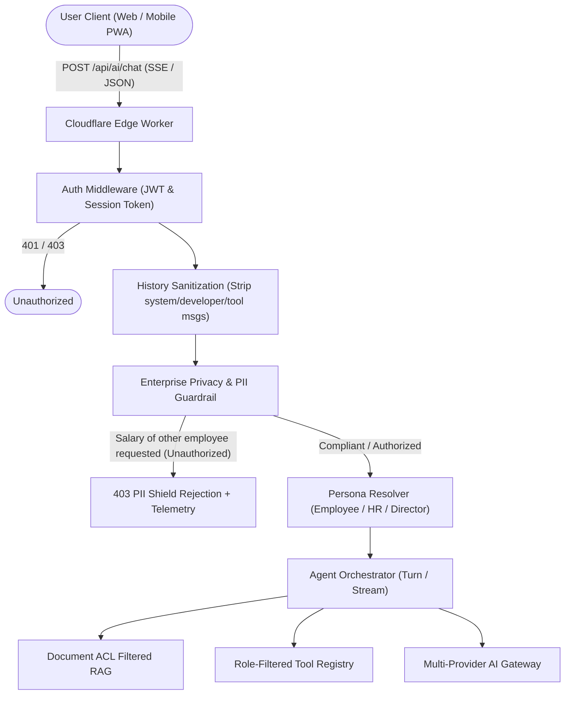
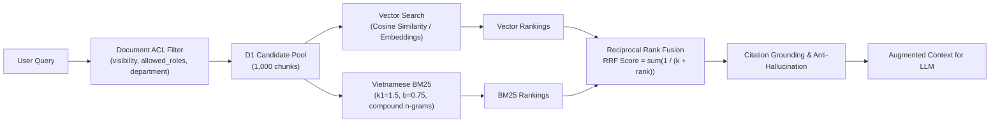
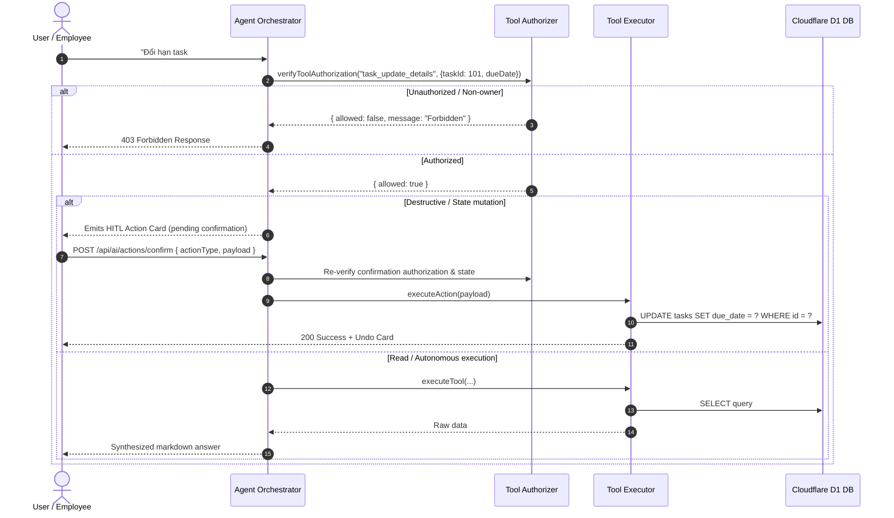
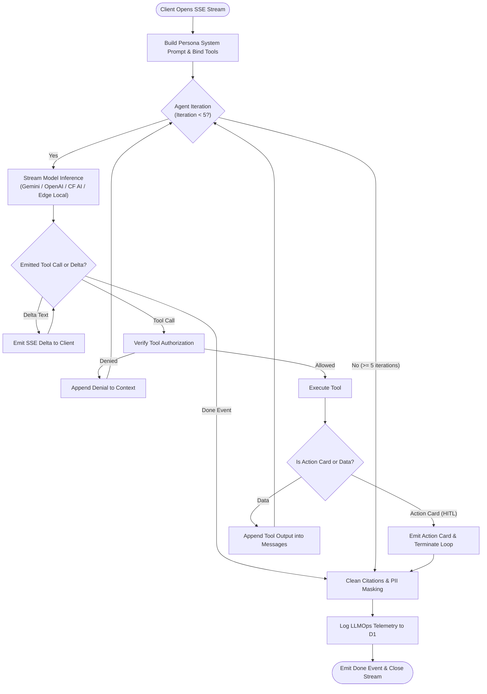
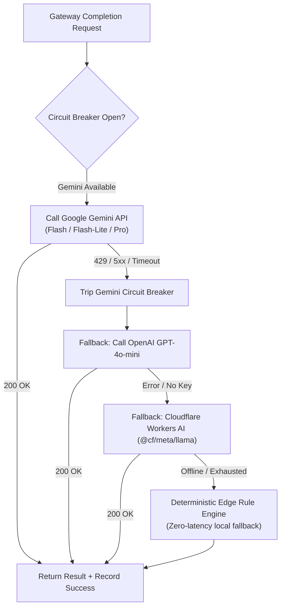
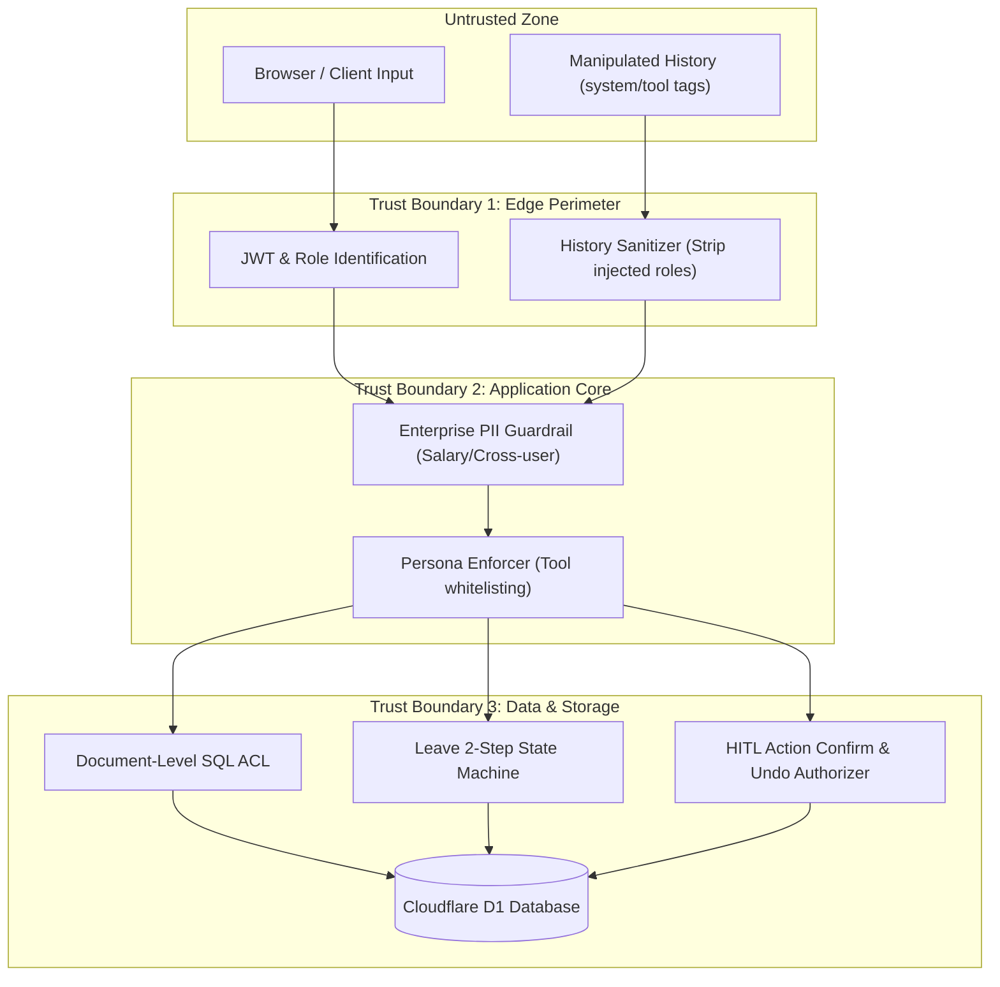

# NetViet HR Enterprise AI Copilot Architecture

## 1. Overview & System Mission

The NetViet HR Enterprise AI Copilot is an edge-first, multi-role intelligent assistant designed for human resources, payroll, task management, internal communication, and knowledge retrieval. 

Operating on Cloudflare Workers, Cloudflare D1 (SQLite), Cloudflare R2, and Durable Objects, the system guarantees high throughput, low latency (< 1.5ms P95 edge retrieval), deterministic enterprise privacy, and strict separation of duties.

---

## 2. System Diagrams

### Diagram 1: AI Request Lifecycle & Guardrails

---

### Diagram 2: RAG Retrieval Pipeline (Document ACL -> BM25 + Vector -> RRF)

---

### Diagram 3: Tool Execution, Authorization & HITL Action Confirmation

---

### Diagram 4: Streaming Agent Orchestration & Parity Loop

---

### Diagram 5: Multi-Provider AI Gateway & Resilience Circuit Breaker

---

### Diagram 6: Security Trust Boundaries & Defense-in-Depth

---

## 3. Key Architectural Decisions & Trade-Offs

| Decision | Chosen Approach | Alternative Considered | Justification |
| :--- | :--- | :--- | :--- |
| **Edge RAG Engine** | Hybrid Okapi BM25 + Vector on Cloudflare D1 | External Vector DB (Pinecone, Qdrant) | Cloudflare D1 provides native co-location with workers, zero egress costs, deterministic SQL ACL filtering, and sub-1.5ms query time without external network hops. |
| **Separation of Duties** | Enforced 2-Step Approval State Machine in DB layer | LLM-prompted approval logic | Prevents prompt injection or API tampering from bypassing administrative hierarchy. State machine rules are immutable. |
| **Action Execution** | Human-in-the-Loop (HITL) Action Cards with Signed Server Confirmation | Fully autonomous background execution | High-risk operational changes (deleting tasks, approving leaves, modifying employee records) require explicit human consent and verification. |
| **Streaming Parity** | Multi-iteration bounded agent loop ($N \le 5$) with typewriter pacing | Single-turn streaming | Ensures users receive streamed synthetic answers even after complex multi-step tool calls, preserving identical behavior between JSON and SSE endpoints. |
| **Multi-Provider Resilience** | Tiered fallback (Gemini $\rightarrow$ OpenAI $\rightarrow$ Workers AI $\rightarrow$ Edge Heuristic) with Circuit Breakers | Single LLM dependency | Guarantees 99.99% availability even during external API outages, rate limits, or offline test suites. |
